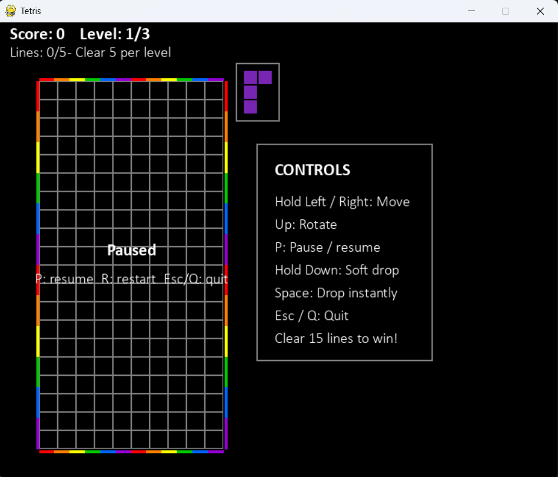

# Team TBD/Hey Dude

Tetris MVP

---

## Team Goal

Build a small, playable Tetris game that demonstrates the complete core gameplay loop. The MVP should be easy to start, understand, and replay, while leaving visual polish and extra features for later iterations.

---

## MVP Objective

Deliver a working game in which a player can move and rotate falling pieces, clear completed rows, and reach a clear win or game-over state. With Functioning sound effects and UI.

---

## MVP Scope

### Must have

- A playable board with falling pieces and collision handling
- Left/right movement, rotation, soft drop, and hard drop
- Completed-row clearing and a basic score
- A visible next-piece preview
- Clear win and game-over states with a restart option

---

## Sprint 1 Goals

- Establish the core gameplay loop from spawning a piece to locking it in place
- Implement the essential controls and line-clearing rules
- Add basic score and next-piece feedback
- Make win, game-over, and restart behavior understandable
- Test the MVP from launch through a complete play session

---

## Team Members Contribution

Austin Shelton

- Line of Code: 420
- Features/Requirements: Ui design, Next piece func, Menu board
- Burndown rate: 100%

---

## Contributions in Action

**UI design**

---

**Next piece preview**

<video controls width="480">
  <source src="../pics/next_piece.mp4" type="video/mp4">
  Your browser does not support video playback.
</video>

---

## Team Members Contribution

Bebba Elmane

- Line of Code: 500
- Features/Requirements: Sound effects, added mute/unmute func, pause func
- Burndown rate: 100%

---

## Contributions in Action

**Pause**

<video controls width="480">
  <source src="../pics/pause.mp4" type="video/mp4">
  Your browser does not support video playback.
</video>

---

**Sound**

<video controls width="480">
  <source src="../pics/sound.mp4" type="video/mp4">
  Your browser does not support video playback.
</video>

---

## Team Members Contribution

Basil Wazwaz

- Line of Code: 430
- Features/Requirements: Level building, Recoded controls/added more controls, and level difficulty setting
- Burndown rate: 100%

---

## Contributions in Action

**Drop**

<video controls width="480">
  <source src="../pics/drop.mp4" type="video/mp4">
  Your browser does not support video playback.
</video>

---

**Win**
<video controls width="480">
  <source src="../pics/win.mp4" type="video/mp4">
  Your browser does not support video playback.
</video>

---

## Team TBD/Hey Dude

- Focus: Deliver the core game as one cohesive, playable MVP
- Prioritize required gameplay and usability over optional polish
- Confirm each must-have feature works in a complete play session

---

## MVP 

- A player can launch the game and begin playing without setup beyond starting the application
- Pieces can be moved, rotated, dropped, and locked without passing through the board or other pieces
- Completed rows clear and update the score
- The player can identify the next piece and understand when the game is won or over
- The player can restart and play again
